# SEVIMA-Mini — Desain Sistem Akademis dengan UML (Materi 1 · Minggu 1)

Repositori ini berisi rancangan arsitektur sistem informasi akademik **SEVIMA-Mini** untuk mata kuliah **Pemrograman Berorientasi Objek (OOP)** dengan pendekatan **AI-First Development**.

Desain pada **Minggu 1 (Eksplorasi & Prompt Engineering)** berfokus pada analisis domain 6 modul akademik, iterasi *prompt engineering*, validasi kritis output AI, refactoring prinsip **SOLID**, serta dokumentasi **Architecture Decision Record (ADR)** sebagai peta implementasi Minggu 3–16.

---

## Struktur Repositori

```text
.
├── diagrams/
│   └── class-diagram.mmd                # Class Diagram final (Mermaid, SOLID & Design Patterns)
├── prompts/
│   └── ai-usage-log.md                  # 6 iterasi prompt, perbandingan AI vs revisi manual, OPAR
├── docs/
│   ├── domain-analysis.md               # Analisis kata benda & kata kerja (Step 1)
│   └── ADR-architecture-decisions.pdf   # Architecture Decision Record (2 halaman PDF)
└── README.md                            # Ringkasan desain & preview diagram
```

---

## Ringkasan Deliverables Minggu 1

| Deliverable | File | Status | Ringkasan |
| :--- | :--- | :---: | :--- |
| **Analisis Domain** | [`docs/domain-analysis.md`](docs/domain-analysis.md) | Selesai | Pemetaan 6 modul (PMB, KRS, Jadwal, Nilai, SPP, Presensi QR) ke kandidat class, atribut, method, dan jenis relasi. |
| **Class Diagram (35%)** | [`diagrams/class-diagram.mmd`](diagrams/class-diagram.mmd) | Selesai | Hierarki `User <<abstract>>`, 5 class inti (`Course`, `Enrollment`, `Schedule`, `Grade`, `Payment`), `ProgramStudi`, `Attendance`, Strategy Pattern KRS, Factory Pattern PMB, bebas *circular dependency*. |
| **AI Usage Log (15%)** | [`prompts/ai-usage-log.md`](prompts/ai-usage-log.md) | Selesai | 6 prompt terbaik beranatomi 5 unsur, perbandingan Before/After output AI vs revisi manual, dan refleksi **OPAR**. |
| **ADR PDF (5%)** | [`docs/ADR-architecture-decisions.pdf`](docs/ADR-architecture-decisions.pdf) | Selesai | 4 keputusan arsitektur (ADR-001 s.d. ADR-004), analisis *trade-off*, dan ringkasan SOLID/Design Patterns. |
| **Commit Incremental** | Riwayat Git (`git log`) | Selesai | Commit bertahap per langkah pengerjaan dengan penanda `[AI-assisted]` sesuai *AI-First Development Charter*. |

---

## Poin Utama Desain Arsitektur

1. **Hierarki User & 5 Pilar OOP**:
   - `User` sebagai `<<abstract>>` base class dengan 4 turunan valid (*is-a*): `Mahasiswa`, `Dosen`, `Admin`, `CalonMahasiswa`.
   - **Encapsulation**: atribut sensitif (`-password`, `-ipk`, `-nilaiAngka`) bersifat *private* (`-`), atribut pewarisan *protected* (`#`), method interaksi *public* (`+`).
   - **Polymorphism**: method abstrak `+tampilkanDashboard()*` diimplementasikan berbeda oleh tiap peran.
2. **Pemodelan Relasi & Anti-Circular Dependency**:
   - **Pemecahan Many-to-Many**: `Mahasiswa <-> Course` dipecah melalui `Enrollment`.
   - **Composition (`*--`)**: `Enrollment *-- Grade`, `Course *-- Schedule`, `Schedule *-- Attendance`.
   - **Aggregation (`o--`)**: `ProgramStudi o-- Dosen`, `ProgramStudi o-- Mahasiswa`, `KRSValidator o-- IValidationRule`.
   - **Self-Association**: `Course --> Course` untuk prasyarat mata kuliah.
   - **Bebas Siklus**: graf relasi diverifikasi bebas *circular dependency*.
3. **SOLID & Design Patterns**:
   - **SRP**: menghindari *God Object* dengan memisahkan `KRSValidator`, `TranscriptService`, dan `NotificationService` dari `Mahasiswa`.
   - **Strategy Pattern (OCP & DIP)**: aturan validasi KRS (`MaxSKSValidationRule`, `PrerequisiteValidationRule`, `ScheduleConflictRule`, `DuplicateEnrollmentRule`) melalui interface `IValidationRule`.
   - **Factory Pattern**: `MahasiswaFactory` membuat objek `Mahasiswa` baru saat `CalonMahasiswa` lulus PMB dan menyimpan keterkaitan `-calonMahasiswaId`.

---

## Preview Class Diagram (Mermaid)

GitHub merender diagram Mermaid di bawah ini secara otomatis (sumber utama: [`diagrams/class-diagram.mmd`](diagrams/class-diagram.mmd)):

```mermaid
classDiagram
    class User {
        <<abstract>>
        #int id
        #String nama
        #String email
        #String username
        -String password
        +login(String username, String password) bool
        +logout() void
        +getNama() String
        +tampilkanDashboard()* void
    }

    class Mahasiswa {
        -String nim
        -int semester
        -float ipk
        -String statusAktif
        -int calonMahasiswaId
        +getNIM() String
        +getIPK() float
        +updateIPK(float ipkBaru) void
        +isiKRS(Course course) Enrollment
        +lihatTranskrip() String
        +scanQRPresensi(String kodeQR) Attendance
        +tampilkanDashboard() void
    }

    class Dosen {
        -String nidn
        -String bidangKeahlian
        +getNIDN() String
        +inputNilai(Enrollment enrollment, float angka) Grade
        +approveKRS(Enrollment enrollment) void
        +tolakKRS(Enrollment enrollment, String alasan) void
        +buatQRPresensi(Schedule schedule) String
        +tampilkanDashboard() void
    }

    class Admin {
        -String nip
        -String departemen
        +verifikasiBerkasPMB(CalonMahasiswa calon) bool
        +generateNIM(CalonMahasiswa calon) String
        +kelolaMataKuliah(Course course) void
        +kelolaJadwal(Schedule schedule) void
        +tampilkanDashboard() void
    }

    class CalonMahasiswa {
        -String noDaftar
        -String statusSeleksi
        -String berkasPath
        +daftarPMB() void
        +unggahBerkas(String filePath) void
        +cekStatusSeleksi() String
        +tampilkanDashboard() void
    }

    class ProgramStudi {
        -String kodeProdi
        -String namaProdi
        +tambahDosen(Dosen dosen) void
        +daftarDosen() List~Dosen~
    }

    class Course {
        -String kode
        -String nama
        -int sks
        -int semesterRekomendasi
        +getKode() String
        +getSKS() int
        +getPrasyarat() List~Course~
        +tambahPrasyarat(Course prasyarat) void
    }

    class Enrollment {
        -int id
        -String semester
        -String tahunAkademik
        -String status
        +ajukan() void
        +setStatus(String status) void
        +getStatus() String
    }

    class Schedule {
        -int id
        -String hari
        -String jamMulai
        -String jamSelesai
        -String ruangan
        +isBentrokDengan(Schedule other) bool
        +getInfoJadwal() String
    }

    class Grade {
        -float nilaiAngka
        -String nilaiHuruf
        -float bobot
        +konversiHuruf() String
        +getBobot() float
    }

    class Payment {
        -int id
        -String semester
        -double jumlah
        -Date tanggalBayar
        -String status
        +bayar(double nominal) bool
        +isLunas() bool
    }

    class Attendance {
        -int id
        -DateTime waktuScan
        -String kodeQR
        -String statusHadir
        +catatKehadiran() void
    }

    class IValidationRule {
        <<interface>>
        +validate(Mahasiswa mhs, Course course, List~Enrollment~ aktif) bool
        +getErrorMessage() String
    }

    class MaxSKSValidationRule {
        -int batasMaksSKS
        +validate(Mahasiswa mhs, Course course, List~Enrollment~ aktif) bool
        +getErrorMessage() String
    }

    class PrerequisiteValidationRule {
        +validate(Mahasiswa mhs, Course course, List~Enrollment~ aktif) bool
        +getErrorMessage() String
    }

    class ScheduleConflictRule {
        +validate(Mahasiswa mhs, Course course, List~Enrollment~ aktif) bool
        +getErrorMessage() String
    }

    class DuplicateEnrollmentRule {
        +validate(Mahasiswa mhs, Course course, List~Enrollment~ aktif) bool
        +getErrorMessage() String
    }

    class KRSValidator {
        -List~IValidationRule~ rules
        +tambahRule(IValidationRule rule) void
        +validasiKRS(Mahasiswa mhs, Course course, List~Enrollment~ aktif) bool
    }

    class TranscriptService {
        +hitungIPS(List~Enrollment~ enrollments) float
        +hitungIPK(List~Enrollment~ enrollments) float
        +generateTranskripPDF(Mahasiswa mhs, List~Enrollment~ enrollments) File
    }

    class INotificationService {
        <<interface>>
        +kirimNotifikasi(User penerima, String pesan) void
    }

    class NotificationService {
        -String channel
        +kirimNotifikasi(User penerima, String pesan) void
    }

    class MahasiswaFactory {
        +buatDariCalon(CalonMahasiswa calon, String nim) Mahasiswa
    }

    User <|-- Mahasiswa
    User <|-- Dosen
    User <|-- Admin
    User <|-- CalonMahasiswa

    IValidationRule <|.. MaxSKSValidationRule
    IValidationRule <|.. PrerequisiteValidationRule
    IValidationRule <|.. ScheduleConflictRule
    IValidationRule <|.. DuplicateEnrollmentRule
    INotificationService <|.. NotificationService

    Enrollment "1" *-- "0..1" Grade : memiliki nilai
    Course "1" *-- "1..*" Schedule : memiliki jadwal
    Schedule "1" *-- "0..*" Attendance : mencatat presensi

    ProgramStudi "1" o-- "1..*" Dosen : menaungi
    ProgramStudi "1" o-- "0..*" Mahasiswa : mendaftarkan
    KRSValidator "1" o-- "1..*" IValidationRule : menerapkan

    Mahasiswa "1" --> "0..*" Enrollment : mengambil
    Course "1" --> "0..*" Enrollment : diikuti melalui
    Course "0..*" --> "0..*" Course : prasyarat
    Mahasiswa "1" --> "0..*" Payment : memiliki tagihan
    Dosen "1" --> "0..*" Schedule : mengampu
    Dosen "1" --> "0..*" Mahasiswa : membimbing PA
    Mahasiswa "1" --> "0..*" Attendance : melakukan presensi

    Admin ..> CalonMahasiswa : memverifikasi
    Admin ..> MahasiswaFactory : memicu pembuatan
    MahasiswaFactory ..> CalonMahasiswa : membaca data
    MahasiswaFactory ..> Mahasiswa : membuat
    TranscriptService ..> Enrollment : membaca
    TranscriptService ..> Grade : menghitung
    KRSValidator ..> INotificationService : mengirim hasil
```



---

## Rencana Minggu 2 (Refinement & Skenario)
- [ ] `diagrams/usecase-diagram.mmd` (Aktor: Mahasiswa, Dosen, Admin, Sistem PMB; relasi `include`/`extend`)
- [ ] `diagrams/sequence-pmb.mmd` (Skenario pendaftaran mahasiswa baru + *alternate flow*)
- [ ] `diagrams/sequence-krs.mmd` (Skenario validasi KRS + pengecekan prasyarat, maks 24 SKS, bentrok jadwal + *error handling*)
- [ ] `docs/Final-UML-diagram.pdf`
