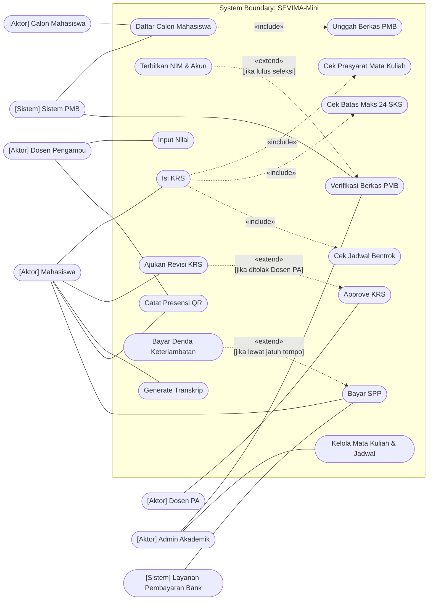
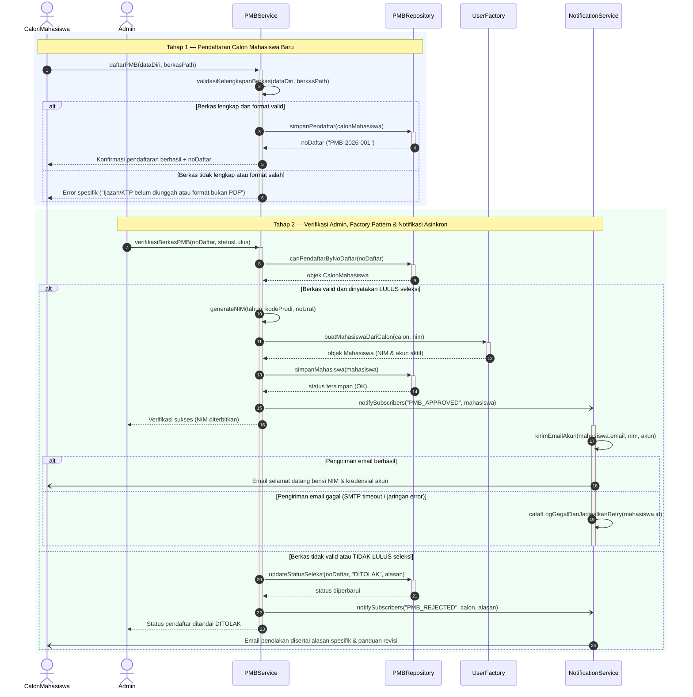
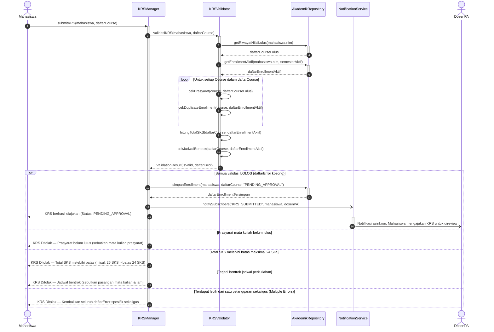

# SEVIMA-Mini — Desain Sistem Akademis dengan UML (Materi 1 · Minggu 1 & 2)

Repositori ini berisi paket desain arsitektur lengkap sistem informasi akademik **SEVIMA-Mini** untuk mata kuliah **Pemrograman Berorientasi Objek (OOP)** dengan pendekatan **AI-First Development**.

- **Minggu 1 (Eksplorasi & Prompt Engineering):** Analisis domain 6 modul akademik, iterasi prompt awal, dan Class Diagram v1.
- **Minggu 2 (Refinement & Skenario):** Pembuatan *Use Case Diagram*, *Sequence Diagram* (PMB & Validasi KRS dengan *alternate flow*), audit kritik mandiri AI, refactoring *God Object* & prinsip **SOLID** lengkap (SRP, OCP, LSP, ISP, DIP), penerapan pola **Factory + Observer + Strategy**, sinkronisasi seluruh diagram, serta dokumentasi **ADR** & **Final UML PDF**.

---

## Struktur Repositori

```text
.
├── diagrams/
│   ├── class-diagram.mmd                   # Class Diagram final Minggu 2 (SOLID, Factory, Observer, Strategy)
│   ├── usecase-diagram.mmd                 # Use Case Diagram (Aktor peran, System Boundary, include/extend)
│   ├── sequence-pmb.mmd                    # Sequence Diagram PMB (Factory, Async Notification, Alternate Flow)
│   ├── sequence-krs.mmd                    # Sequence Diagram Validasi KRS (Loop, Self-call, Alternate Flow)
│   └── before-after/
│       ├── class-diagram-week1-before.mmd  # Baseline Class Diagram Minggu 1 (sebelum refactor Minggu 2)
│       ├── before-class-diagram-w1.png     # Screenshot visual Before (Minggu 1)
│       └── after-class-diagram-w2.png      # Screenshot visual After (Minggu 2)
├── prompts/
│   └── ai-usage-log.md                     # 12 prompt terbaik (Minggu 1 & 2), Before/After, refleksi OPAR
├── docs/
│   ├── domain-analysis.md                  # Analisis kata benda & kata kerja (Minggu 1)
│   ├── ADR-architecture-decisions.md       # Sumber teks ADR-001 s.d. ADR-007
│   ├── ADR-architecture-decisions.pdf      # Architecture Decision Record final (PDF)
│   └── Final-UML-diagram.pdf               # Paket seluruh UML Diagram final (PDF)
└── README.md                               # Ringkasan desain, checklist deliverable & preview diagram
```

---

## Ringkasan Deliverables & Bobot Penilaian (Minggu 2)

| Deliverable | Bobot | File Utama | Status | Ringkasan |
| :--- | :---: | :--- | :---: | :--- |
| **Class Diagram (Revisi)** | **35%** | [`diagrams/class-diagram.mmd`](diagrams/class-diagram.mmd) | Selesai | Bebas *God Object* (< 10 method/class), SOLID lengkap (SRP, OCP, LSP, ISP, DIP), **Factory (`UserFactory`)**, **Observer (`EventBus` + `IEventSubscriber`)**, **Strategy (`IValidationRule`)**, sinkron 100% dengan Sequence Diagram. |
| **Use Case Diagram** | **20%** | [`diagrams/usecase-diagram.mmd`](diagrams/usecase-diagram.mmd) | Selesai | Aktor: Calon Mahasiswa, Mahasiswa, Dosen Pengampu, Dosen PA, Admin Akademik, Sistem PMB, Layanan Bank. Lengkap dengan `<<include>>` dan `<<extend>>` berarah panah valid. |
| **Sequence Diagram** | **25%** | [`diagrams/sequence-pmb.mmd`](diagrams/sequence-pmb.mmd)<br>[`diagrams/sequence-krs.mmd`](diagrams/sequence-krs.mmd) | Selesai | 2 skenario utama (PMB & Validasi KRS) lengkap dengan `loop`, *self-call*, pesan asinkron (`-)`), dan **`alt` (*alternate flow* / error handling spesifik)**. |
| **AI Usage Documentation** | **15%** | [`prompts/ai-usage-log.md`](prompts/ai-usage-log.md) | Selesai | 6 prompt terbaik Minggu 2 (+ 6 Minggu 1), perbandingan *Before vs After*, bukti visual screenshot, dan refleksi **OPAR**. |
| **ADR (PDF)** | **5%** | [`docs/ADR-architecture-decisions.pdf`](docs/ADR-architecture-decisions.pdf) | Selesai | 7 keputusan arsitektur (ADR-001 s.d. ADR-007) lengkap dengan Konteks, Keputusan, Alternatif & Trade-off, Konsekuensi (+/-), dan Pattern. |
| **Final UML PDF** | Wajib | [`docs/Final-UML-diagram.pdf`](docs/Final-UML-diagram.pdf) | Selesai | Kompilasi rapi Class Diagram, Use Case Diagram, Sequence PMB, dan Sequence KRS dalam satu dokumen PDF siap kumpul di EdLink. |

---

## Preview Diagram UML (Mermaid)

### 1. Use Case Diagram (`diagrams/usecase-diagram.mmd`)



---

### 2. Sequence Diagram — Pendaftaran Mahasiswa Baru / PMB (`diagrams/sequence-pmb.mmd`)



---

### 3. Sequence Diagram — Validasi & Pengajuan KRS (`diagrams/sequence-krs.mmd`)



---

### 4. Class Diagram Final (`diagrams/class-diagram.mmd`)

Lihat sumber lengkap di [`diagrams/class-diagram.mmd`](diagrams/class-diagram.mmd) (perbandingan dengan Minggu 1 tersedia di [`diagrams/before-after/`](diagrams/before-after/)).

---

## Kesiapan Implementasi Minggu 3 (Modul PMB)
Desain `PMBService`, `PMBRepository`, `UserFactory`, dan `sequence-pmb.mmd` siap langsung diturunkan menjadi kode program (skema tabel pendaftar, endpoint `register` & `approve`, generator NIM `tahun + kodeProdi + noUrut`, validasi input, dan unit test) mulai Minggu ke-3.
