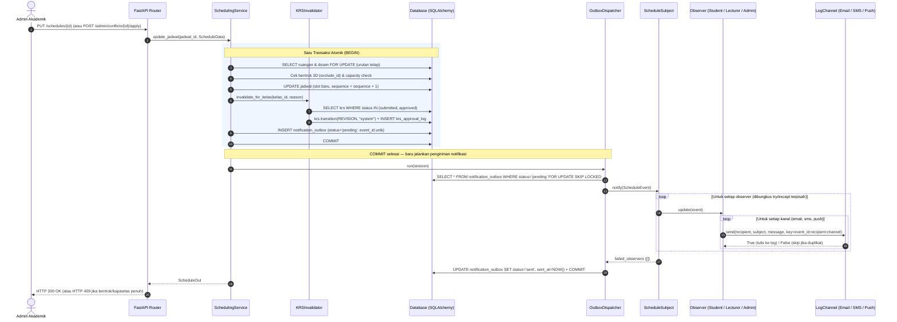

# UML Sequence Diagram — Observer Pattern & Transactional Outbox (Minggu 8)

> **Deliverable Wajib (Minggu 8):** Diagram interaksi berikut disusun sesuai kode aktual pada `app/routers/schedule.py`, `app/services/scheduling_service.py`, `app/services/krs_invalidator.py`, `app/observers/outbox_dispatcher.py`, `app/observers/subject.py`, dan `app/observers/channels.py`.

## Alur Perubahan Jadwal (`PUT /schedules/{id}` atau `POST /admin/conflicts/{id}/apply`)

Perhatikan posisi **`COMMIT`** yang terjadi **SEBELUM** `OutboxDispatcher` memanggil `ScheduleSubject.notify(event)`. Dengan urutan ini, kegagalan validasi/commit tidak akan pernah mengirim notifikasi palsu, dan kegagalan salah satu observer tidak akan pernah membatalkan perubahan jadwal yang sudah sah.

## Catatan Arsitektur Kunci untuk Viva

1. **Kenapa `COMMIT` sebelum `notify()`?**
   Jika `notify()` dipanggil sebelum `COMMIT` dan kemudian `COMMIT` gagal (mis. constraint DB atau deadlock), mahasiswa dan dosen sudah terlanjur menerima pemberitahuan tentang perubahan jadwal yang tidak pernah terjadi. Dengan Transactional Outbox, perubahan jadwal + invalidasi KRS + baris `notification_outbox` di-commit bersama-sama secara atomik.
2. **Bagaimana jika salah satu observer gagal (mis. SMS gateway mati)?**
   Setiap `observer.update(event)` dibungkus `try/except` terpisah sehingga observer lain tetap menerima notifikasi. `OutboxDispatcher` mencatat `attempts += 1` dan membiarkan baris tetap `pending` (maks 5 kali percobaan sebelum `failed`). Saat dicoba ulang, observer yang sebelumnya sudah sukses tidak mengirim pesan ganda karena setiap `LogChannel` memeriksa **kunci idempotensi** (`event_id:recipient:channel`).
3. **Di mana `attach()` dipanggil?**
   Di `app/runtime.py` (`init_notification_runtime()`) saat aplikasi FastAPI start (`lifespan`), **bukan** di dalam endpoint request — sehingga tidak ada kebocoran memori maupun duplikasi notifikasi saat request berulang.
